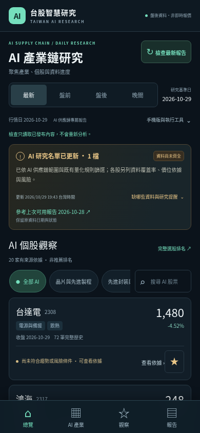

# AI 供應鏈正式版驗證

驗證日：2026-10-29（Asia/Taipei）。程式提交 [`c3c9786`](https://github.com/shen19772002-sketch/taiwan-stock-ai/commit/c3c978654cbdf792d49dd0d02072e8551699f4b0) 已推送 `main`；沿用原專案、排程與資料分支，沒有重新建立專案。

## 範圍與來源

分類版本 `2026.10.29.1` 共核對 36 家候選：20 家取得可核實的一手業務來源而啟用，16 家待確認而排除。8 類主要分類均有成分股；這不是完整的台股 AI 公司母體。

來源保留網址、標題、實際回應雜湊、業務摘錄、確認狀態及可知日期。例如台積電採 NVIDIA 官方 Blackwell 公告的技術合作證據；台光電、台達電、建準與健策採公司官網的 AI／資料中心／產品業務說明。來源種類逐筆標示，不把合作方公告寫成公司自身公告，也不宣稱 AI 營收占比。

分析在評分前依精確市場與代號限定 AI 範圍，主分類參與產業強弱及成交額統計，次標籤不重複計入成交額。分類證據晚於研究日者排除；目前分類日期粒度為日，並非完整的盤中發布時點資料庫。

## 已完成的驗證

- **260 項 pytest、Ruff、JavaScript 語法檢查通過**。涵蓋分析前過濾、分類日期、同日估值、AI 產業分母、舊報告與原始訊號不變、非 AI 持股行情保留。
- **套件驗證通過**：建立的 wheel 實際包含 `taiwan_stock_ai/data/ai_universe.json` 與 `static/ai-view.js`；分類檔不因行情目錄的 Git 忽略規則而遺漏。
- **真實資料瀏覽器驗證通過**：360×800、390×844、844×390、1440×1100 四個尺寸，各檢查最新、盤前、盤後及晚間頁面。分類篩選、搜尋、個股依據、來源連結、本機自選股、非 AI 持股價格隔離及原有研究區塊均通過；沒有橫向溢位或 JavaScript 錯誤。
- **PWA 回歸通過**：桌面及 Android 尺寸的服務工作者、已儲存報告離線閱讀、缺頁回退、更新檢查錯誤／逾時／連點、防止強制刷新、自選股與其他專案快取保存均通過。一般 Chromium 設定檔的可安裝檢查為零錯誤；安裝事件模擬不等同實體手機安裝驗證。

瀏覽器驗證使用既有真實行情產生的網站檔案，在 localhost 的 `/taiwan-stock-ai/` 子路徑執行；沒有注入示範行情。發布後另以下述正式網站下載檔核對，與本機資料測試分別記錄。

## 盤前與盤後資料結果

| 本機驗證模式 | 行情日期 | AI 觀察股票 | 技術歷史就緒 | 同日估值 | 合格候選 |
| --- | --- | ---: | ---: | ---: | ---: |
| 盤前：使用已保存真實資料，離線執行 | 2026-10-28 | 20 | 20 | 20 | 4 |
| 盤後：實際擷取官方 API | 2026-10-29 | 20 | 20 | 2 | 0 |

盤前驗證沒有重新取得官方來源，報告保留 `source_mode=retained` 與原行情日期。盤後仍為 `partial`：部分 TWSE 指定日期 API 在本機回傳無法解析的 JSON，來源錯誤與等待狀態保留；不把前日估值當成今日資料，也不為湊足名單填入股票或價位。

候選為零不代表全部缺少 60 日歷史。本次 20 檔均有技術歷史，主要缺漏是同日估值；資料齊全後仍須通過趨勢及風險條件才能入選。

## 歷史保存與更新限制

測試確認舊全市場報告、已記錄訊號及資料日期不被 AI 範圍改版覆蓋。介面保留舊報告原範圍；歷史績效可能混有先前全市場訊號，不能宣稱為 AI 專屬回測。

既有盤前、盤後及晚間排程沿用真實執行入口。晚間會重新擷取官方資料，實際補齊仍取決於來源公布與 GitHub 排程；不會持續輪詢到完整，也不自動回補所有舊日期缺口。分類名單需要版本化維護，每日行情排程不會自行從新聞新增公司。

## 遠端與公開網站驗證

- [CI 40866724704](https://github.com/shen19772002-sketch/taiwan-stock-ai/actions/runs/40866724704)：成功。Python 3.11／3.12 測試、PWA 與 AI 手機介面的 Chromium 檢查均通過。
- [正式盤前 40867016653](https://github.com/shen19772002-sketch/taiwan-stock-ai/actions/runs/40867016653)、[正式盤後 40867021455](https://github.com/shen19772002-sketch/taiwan-stock-ai/actions/runs/40867021455) 均成功完成資料收集、資料庫檢查、永久歷史保存及 Pages 部署。兩次均以程式提交 `c3c9786` 執行。
- 盤前使用 2026-10-28 行情，20 檔具有同日估值與技術歷史，4 檔入選。TPEx 即時擷取曾回報 `ChunkedEncodingError`，報告保留錯誤，使用已保存且日期合格的真實行情，沒有偽稱全部來源成功。
- 盤後使用 2026-10-29 行情，20 檔具有同日行情、估值及技術歷史，1 檔入選；上市、上櫃法人資料均為同日。此輪無來源連線錯誤，因全市場行情回應仍有必要欄位不完整的列被拒收，整體狀態保留 `partial`，不冒稱全部來源資料完整。
- 永久分支比對：從原有 35 份報告增加為 37 份；原有每個報告路徑與 Git blob SHA 均保持相同，沒有覆蓋或遺失。驗證時分支為 `01b338e0537595f6ee3906692c052ae2a49b7eb1`。
- [正式網站](https://shen19772002-sketch.github.io/taiwan-stock-ai/) 的 20 個檔案均回傳 HTTP 200，使用預設 TLS 憑證驗證。腳本、CSS、圖示及服務工作者與來源相同；四頁內嵌報告、公開 JSON、發布指紋一致。PWA 介面版本 `1c67cc888af861310d92`。
- 最新、盤前、盤後頁均確認為 20 家、8 類的 AI 專屬報告。晚間頁保留原始 2026-10-28 全市場報告並明示舊範圍，沒有回寫舊報告；下一次晚間排程會沿用新的預設 AI 分析入口。

正式網站下載檔的四尺寸、四頁瀏覽器驗證亦全部通過；沒有 JavaScript 錯誤、橫向溢位或寫入請求。個股價格／日期逐一與公開報告核對，自選股與非 AI 既有持股功能保留。

完整可機讀結果見 [發布驗證 JSON](evidence/ai-release-2026-10-29.json)。下圖為正式網站檔案的 Chromium 390×844 模擬，並非實體 Android 截圖。

操作與研究範圍見 [AI 供應鏈研究版說明](ai-supply-chain.md)，安裝方式見 [PWA 說明](pwa.md)。
