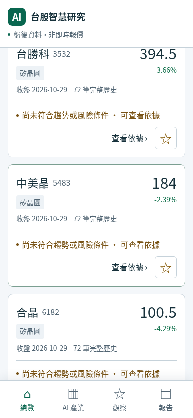
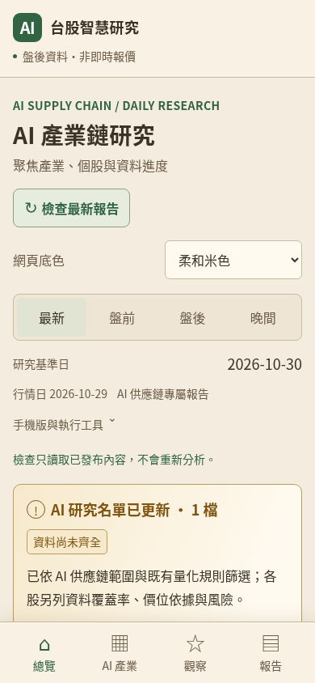

# 大字、底色與矽晶圓觀察

手機版預設保留深海藍底色，放大主要文字、日期與資料狀態。頁面上方的「底色」可切換深海藍、明亮白、柔和米色；卡片、表格及圖表同步變更。字體放大後每屏顯示的內容較少，可上下捲動查看。

底色偏好只儲存在目前瀏覽器。重新開啟、切換時段或讀取已儲存的離線頁面會沿用；不同裝置不會自動同步。清除網站資料也會清除偏好。既有自選股與持股成本使用原本的儲存格式，底色切換不會改動研究結果或個人持股。

已安裝 PWA 若出現「更新手機版」，按下後套用新介面。離線仍保留報告原本的行情日期，不會變成即時報價。

## 矽晶圓分類

名單版本 `2026.10.30.1` 新增下列四家公司，共 24 家已啟用公司、9 類；另有 16 家仍待核實。

| 代號 | 公司 | 觀察關係 |
| --- | --- | --- |
| 6488 | 環球晶 | 半導體矽晶圓，上游材料間接題材 |
| 3532 | 台勝科 | 官方產品頁標示半導體用矽晶圓製品 |
| 6182 | 合晶 | 半導體矽晶圓，上游材料間接題材 |
| 5483 | 中美晶 | 集團與轉投資曝險，與環球晶具共同曝險 |

矽晶圓是半導體上游材料，研究分類標示為 **AI 上游間接題材**，不表示全部營收來自 AI，也不表示已取得特定 AI 訂單。中美晶另標示集團轉投資關係，不將母子公司視為互相獨立的需求或直接推估 AI 營收。

分類先以公司一手業務資料核實，再依可知日期納入。新分類不回填到啟用前的歷史預測，舊報告維持原來的分類快照與名單。加入觀察範圍也不等於進入推薦排名；行情、估值、技術歷史與風險條件仍沿用既有規則。

原有官方資料收集、每日排程、永久資料分支與報告歷史均保留。完整分類名單與來源見 [ai_universe.json](../src/taiwan_stock_ai/data/ai_universe.json)，研究規則見 [AI 供應鏈說明](ai-supply-chain.md)。

## 驗證

2026-10-30 的本機完整測試共 262 項通過，Ruff 與 JavaScript 語法檢查通過。四家矽晶圓觀察股均可使用既有資料庫的 2026-10-29 真實行情、同日估值及 72 筆有效歷史資料，未以示範行情代替。

真實報告通過四尺寸、四時段頁面的 AI 操作驗證。三種底色的文字對比、字體大小、圖表配色與資料不變、自選股保存、跨頁與離線、儲存失敗時仍可操作，均經 Chromium 驗證；這是瀏覽器尺寸模擬，非實體 Android 安裝驗證。正常設定檔的 PWA 可安裝檢查回報零錯誤。

程式提交 [`549aab3`](https://github.com/shen19772002-sketch/taiwan-stock-ai/commit/549aab38e818cadfe777df8841a7bd323d4766bf) 的 [CI 40990507105](https://github.com/shen19772002-sketch/taiwan-stock-ai/actions/runs/40990507105) 成功，Python 3.11／3.12 及 AI、PWA、三種底色的瀏覽器檢查均通過。

[正式執行 40990847197](https://github.com/shen19772002-sketch/taiwan-stock-ai/actions/runs/40990847197) 成功完成真實資料收集、資料庫驗證、永久歷史保存及 GitHub Pages 部署。最新 2026-10-30 盤前研究採 2026-10-29 行情，24 檔均有同日行情、估值與技術歷史，1 檔通過選股條件。上市及上櫃法人資料與行情日對齊；官方全市場行情回應仍有必要欄位不完整的列被拒收，因此整體狀態保留 `partial`。

發布後以預設 TLS 憑證驗證下載公開網站 21 個檔案，均回傳 HTTP 200，程式、樣式、圖示及服務工作者與來源相同；四頁內嵌報告、公開 JSON、發布指紋一致。PWA 介面版本 `ecf3e6381f69284a11f3`。

永久資料分支由原有 39 份報告增加為 40 份；原有每個路徑的 Git blob SHA 均相同，沒有覆蓋或遺失。盤後及晚間頁仍保留原日期的 20 家／8 類快照，新的排程才使用 24 家／9 類名單。

使用正式網站下載檔的三色完整瀏覽器驗證再次通過。另逐一核對公開的四家矽晶圓卡片價格、日期與原報告相符，並確認中美晶集團轉投資理由與一手來源可見。

完整可機讀證據見 [發布驗證 JSON](evidence/wafer-and-themes-2026-10-30.json)。下圖為正式網站檔案的 Chromium 390×844 模擬，非實體手機截圖。

| 矽晶圓分類／明亮白 | 柔和米色 |
| --- | --- |
|  |  |
