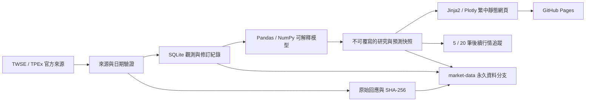

# V1.0 系統架構

## 執行路徑

行情採官方盤後來源，涵蓋上市及上櫃普通股。官方公司名單決定商品範圍，排除 ETF、權證、特別股。原始回應與 manifest 保存 URL、交易日期、擷取時間、SHA-256、接受／拒絕筆數與狀態；來源失敗不補造資料。

## 模組邊界

| 模組 | 職責 |
| --- | --- |
| `providers.py` | 官方行情、估值、公司名單、行事曆；TWSE 有日期備援；有限重試暫時性錯誤 |
| `backfill.py` | 官方歷史行情，逐日保存，供目前股票範圍的指標暖機 |
| `storage.py` | 觀測修訂、時間截點查詢、不可變預測、完整性與一致性備份 |
| `analytics.py` | 市場廣度、技術指標、產業強弱、評分及風險價位 |
| `performance.py` | 已記錄訊號的後續固定持有期觀察，含費稅與滑價 |
| `pipeline.py` | 排程階段、休市／資料不足處理、報告及網站產生 |
| `site.py`、`templates/`、`static/` | 繁中頁面、互動圖、自選與本機持股 |
| `research.py` | 未來新聞與 LLM 擴充介面；目前不呼叫 LLM |
| `scripts/persist_data.py` | 資料分支壓縮分塊、校驗與還原 |

`Store` 是儲存層邊界，未來可替換 PostgreSQL／物件儲存。V1 採 SQLite，配合 Actions concurrency 排除同時改寫。大量資料時應遷移至物件儲存；分塊解決單檔限制，不等於 Git 無限容量。

## 時間與預測紀錄

1. 行情交易日與 `fetched_at` 實際取得時間分別保存，不可互換。
2. 資料修訂追加新觀測，原始回應與舊內容保留。
3. 分析查詢限制 `date <= as_of` 與 `fetched_at <= generated_at`。
4. 同一股票當日首個合格訊號固定保存；重跑追加報告，不修改原訊號。
5. 回補歷史不能創造「當年就知道」的預測；歷史 `--as-of` 不是 point-in-time 回測。
6. 績效從訊號實際記錄日之後的第一筆完整行情開始；記錄時間不是 Pages 正式公開時間。

回補使用目前公司名單，存在存活者偏差；尚無完整下市與公司行動歷史，不可宣稱無偏投組回測或總報酬。

## 排程與品質

台灣時間 08:20 使用最近盤後資料做盤前研究；12:30 無授權即時來源，明確停用行情更新；15:30 初報；18:30／20:30 重試已公布資料。GitHub Actions 可能延遲或漏跑。

週末與已確認官方休市日跳過新訊號；日曆不完整維持未知，不能把來源失敗推斷為休市。臨時休市亦須官方證據，未接入時顯示等待。

- `ready`：所需行情與技術歷史可用，不代表保證未來報酬。
- `partial`：來源、涵蓋、日期或交易日確認仍不完整。
- `waiting`：無資料、歷史不足或盤中來源未啟用。
- `non_trading_day`：已確認休市，不產生新訊號。

`final` 是晚間排程階段，不能冒充法人及所有官方資料已齊全。沒有法人明細時保留缺值。

## 擴充順序

第一階段完成資料、儲存、基本模型、前 15 名規則、價位、七個網頁區域、排程及測試。另有探索性產業階段與前瞻追蹤框架。

下一步接入官方法人買賣超、財報公布時點、公司行動與下市資料；再建立含成交條件、漲跌停、成本及樣本外驗證的正式回測。之後擴充新聞題材生命週期、輪動預測與 OpenAI 深度研究。TAIFEX 尚未作為 V1 必要來源。

頁面展示公開研究資料；自選與持股只存在瀏覽器 localStorage，不進入資料分支。沒有下單功能。將來 API 金鑰只能使用 GitHub Secrets／安全環境綁定，禁止寫入程式、快照、報告與前端。
