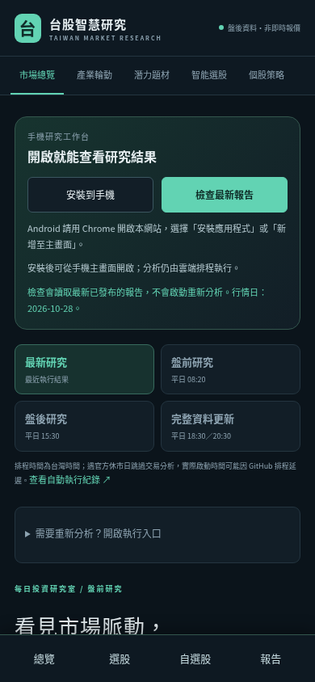
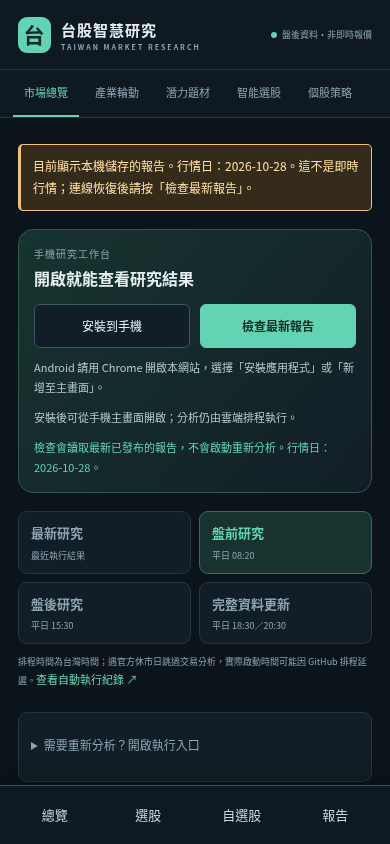

# PWA 手機版驗證

驗證日：2026-10-29（Asia/Taipei）。手機版沿用既有分析引擎、資料分支與公開網站，沒有改寫行情、原始預測或個人自選股格式。

## 程式與操作

功能提交 `329a058`；CI 相容性修正 `67c9457`。

- 新增安裝 manifest、192／512 像素圖示與 maskable 圖示、服務工作者、離線說明頁。
- 新增安裝、報告更新檢查、介面更新確認及手機底部捷徑。
- 發布摘要與每頁穩定指紋分開記錄；相同報告不改寫原產生時間，盤後更新不影響未變更的盤前頁。
- 更新檢查只發出同來源 GET，不會觸發 GitHub 分析或傳送自選股。原 GitHub 執行入口保留在展開區塊。
- 只保留專案內已列明的公開檔案；清理快取不影響其他專案，沒有公開寫入憑證。

本機 **224 項 pytest、Ruff、JavaScript 語法檢查**通過。原有分析與資料保存測試保留。

## 真實瀏覽器與離線驗證

使用正式網站下載的真實研究報告，在 localhost 的 `/taiwan-stock-ai/` 子路徑驗證。測試不改變行情；只在測試伺服器注入網路斷線、HTTP 錯誤或發布版本變更。

桌機 1440×1000、Android 尺寸 390×844 均通過：

- 相同／新報告、503、無效發布摘要、8 秒逾時及執行中連點防重。
- 真實服務工作者註冊，已開啟頁面離線後保留完整原報告與行情日期。
- 未儲存的時段顯示離線說明，不冒用其他時段內容。
- 瀏覽器仍顯示在線但網站請求失敗時，快取副本仍有醒目標示。
- 介面更新等待使用者確認後才重新載入，自選股及其他專案快取仍保留。
- 四個時段頁面無橫向溢位、無 JavaScript 錯誤，原有內容區塊保留。

已修正測試發現的離線導覽互等問題：回傳快取頁面不等待新頁面 client 就緒。手機版也改為顯示原先被隱藏的行情日期。這兩項均由瀏覽器回歸測試覆蓋。

一般臨時使用者設定檔的 Chromium 可安裝檢查回傳零錯誤。獨立情境使用 Playwright 無痕設定檔，因此其診斷只回報 `in-incognito`，不把此環境限制誤判為 manifest 錯誤。安裝按鈕事件另有模擬測試；沒有宣稱已替使用者的實體 Android 手機完成安裝。

## 自動化

`scripts/pwa_smoke.py` 已接入 Python 3.12 的 GitHub CI，使用 Chromium 真實執行上述流程，並保留截圖與 JSON 證據 14 天。CI 使用空資料的誠實等待頁，沒有將測試行情發布到正式網站。

第一次遠端 CI `40795309674` 因 `ubuntu-latest` 升級到既有 Playwright 不支援的 Ubuntu 26 而中止瀏覽器安裝；已把 CI 固定為受支援的 Ubuntu 24.04。這項調整僅影響測試執行環境。

修正後 [CI 40795455854](https://github.com/shen19772002-sketch/taiwan-stock-ai/actions/runs/40795455854) 全部成功：Python 3.11／3.12 各 224 項測試通過，Python 3.12 的 Chromium 安裝、完整 PWA 瀏覽器驗證及證據上傳也成功。

## 正式發布與歷史保存

[正式發布 40795718213](https://github.com/shen19772002-sketch/taiwan-stock-ai/actions/runs/40795718213) 已成功完成真實資料收集、資料庫驗證、永久歷史保存及 GitHub Pages 部署；部署完成時間為台灣時間 2026-10-29 08:44:25。網站沿用 [原研究網址](https://shen19772002-sketch.github.io/taiwan-stock-ai/)，手機程式版本為 `060b4b244b56d282ac38`。

發布後以預設 TLS 憑證驗證下載正式網站 19 個檔案，逐一核對 HTTP 200、服務工作者與 manifest 的 Content-Type、程式／圖示與來源一致、四頁內嵌報告與公開 JSON 一致、發布指紋與報告日期一致。再以這批正式檔案於相同專案子路徑執行 `scripts/pwa_smoke.py`，桌機與 Android 尺寸的完整瀏覽器驗證再次通過，沒有 JavaScript 錯誤。

目前發布的 2026-10-29 盤前報告採用 2026-10-28 行情，列出 15 檔研究候選；盤後／完整報告頁保留最近的 2026-10-28 報告。資料狀態仍為 `partial`：必要欄位不完整的行情列已排除，交易日曆完整性也尚未全數驗證。PWA 不會將這些狀態改成資料完整，也不會將舊行情顯示成盤中即時行情。

永久資料分支 `market-data` 在驗證時為 `318806160e5441e22bb590de56b3cdb40e53d785`，共 32 份不可變報告。與開發前基線比較，原有 28 份的每個 Git blob SHA 均相同，沒有遺失或覆蓋。

可機讀的部署、HTTP 檔案雜湊、瀏覽器流程及歷史保存證據見 [完整驗證 JSON](evidence/pwa-2026-10-29.json)。下圖為 Chromium 的 Android 尺寸模擬，非實體手機截圖。

| 正常連線 | 已儲存的離線報告 |
| --- | --- |
|  |  |

安裝方式及使用範圍見 [PWA 手機版說明](pwa.md)。
