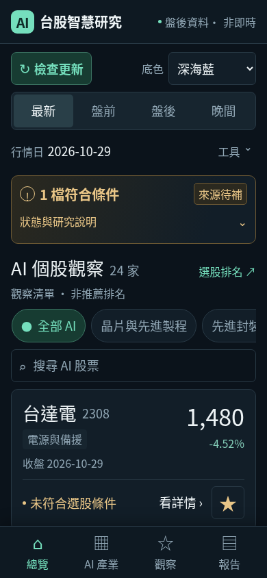

# 手機精簡閱讀版

本次先評估原畫面，再調整顯示。390×844 手機模擬中，原本第一張觀察卡片距頁首約 1,098px；重複標題、日期、長說明與工具分行，讓放大的文字推遲個股內容。

新版採正文 18px、輔助文字至少 16px、股名 26px、手機價格 34px，並將更新與底色併為一列。相同真實報告的首張卡片位置降至約 568px；360px 寬度約為 565px。數值為 Chromium 尺寸模擬，並非實體手機量測。

## 首頁先看什麼

- 行情日與「盤後資料・非即時」標示。
- 入選檔數與「來源待補」等完整性狀態，兩者分開顯示。
- 每股名稱、代號、收盤、漲跌、主要分類及行情日期。
- 「行情待更新」「估值待補」「歷史不足」「未符合選股條件」等短狀態。

研究基準日、報告更新時間、資料缺漏明細及來源說明可展開「狀態與研究說明」。股票的次分類、有效歷史筆數、完整指標、評分依據、價位及風險仍在「看詳情」。

全部觀察清單先顯示 6 家，按「查看全部 24 家」展開，亦可收合。順序依股票代號，並非推薦排名；搜尋與分類直接顯示所有符合結果，不受 6 家限制。自選股變動時會保留展開狀態。

三種底色、PWA、四種時段、24 家及矽晶圓分類、原有報告與個人持股功能持續保留。「檢查更新」只讀取已發布內容，實際查詢或錯誤回饋會顯示在頁面上。

## 資料與驗證

本次不更動研究引擎、價格、評分或選股規則。相同四份報告以新介面重建後，公開 JSON 檔案逐位元組相同；改變的是 HTML 與顯示方式。缺漏、過期行情、非即時標示及風險資訊仍可查閱。

## 正式發布

程式變更 [`45fa8fd`](https://github.com/shen19772002-sketch/taiwan-stock-ai/commit/45fa8fd0e4fa323c75687872debd12d9acfb804c) 與按鈕說明統一 [`eaa30e8`](https://github.com/shen19772002-sketch/taiwan-stock-ai/commit/eaa30e802fa72c9ea5f36e75102442759051325a) 已發布。

[最新版 CI 41002246126](https://github.com/shen19772002-sketch/taiwan-stock-ai/actions/runs/41002246126) 成功：Python 3.11／3.12、262 項測試、AI 操作、三色與 PWA 瀏覽器驗證均通過。[正式工作 41002307203](https://github.com/shen19772002-sketch/taiwan-stock-ai/actions/runs/41002307203) 完成資料收集、資料庫驗證、歷史保存與 GitHub Pages 部署。

公開網站 21 個檔案以預設 TLS 憑證驗證下載，皆回傳 HTTP 200；腳本、樣式、圖示、服務工作者與來源一致。四頁報告 JSON 與改版前逐位元組相同，行情日期與原報告產生時間保持原值。介面版本為 `5093ffc3e9307a955f34`。

永久資料分支比對確認原有 40 份報告的路徑與 Git blob SHA 全部保持不變，這次相同資料沒有新增重複報告。

最後使用正式網站下載檔執行 AI 操作與三種底色的四尺寸、四頁 Chromium 驗證，皆通過。覆蓋價格／日期逐股核對、6→24→6、末檔搜尋、次分類完整篩選、歷史筆數與風險詳情、自選股、離線與儲存例外處理；沒有 JavaScript 錯誤或寫入請求。

機讀結果見 [完整驗證 JSON](evidence/simple-display-2026-10-30.json)。下圖為正式網站檔案的 390×844 Chromium 模擬，非實體手機截圖。

